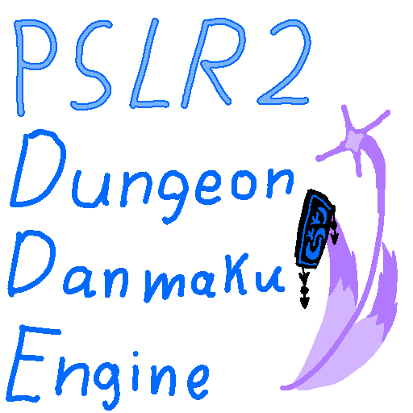

A Danmaku Dungeon framework for Godot 4. currently in active development. to be used in Project Sleepwalker 2 : Explorers of the truth, though the framework itself will be open sourced.

will have support for basic user made spell cards. has 6 bullets, 5 shooting modes, of which 4 of them take math functions. it's basically a graphing calculator, with but a bullet hell framework strapped on top of it.

current timeline :
> make player (done)
> make partner (done)
> make enemy (done)
> make bullets (done)
> code in effects, bullet interactions with entities above. (done)
> saving / loading attacks efficently
> adding bullet erasers
> adding dodge mechanics
> adding inventory
> adding pause functionality
> adding items / item effects
> saving / loading inventory efficently
> adding dodge mechanics.
> alot, alot of testing.
